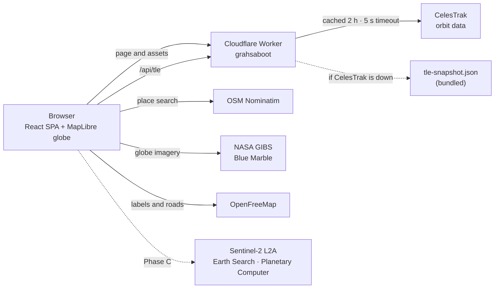

# GrahSaboot

**Satellite proof for any place.** _Grah_ (ग्रह) means planet and _Saboot_ (सबूत) means proof.

GrahSaboot turns a place and a set of dates into dated, cloud-checked satellite evidence from free Sentinel-2 imagery. The goal is to let anyone check what was visible from above, for example whether a road or building really appeared where and when it was claimed, at no cost.

**Live prototype:** https://grahsaboot.grahsaboot.workers.dev


---

## What works in this prototype

- **A live 3D globe.** NASA Blue Marble imagery on a MapLibre globe that rotates slowly on large screens. It has a dark theme (the default) and a light theme.
- **Live Earth-observation satellites.** Sentinel-2A, 2B and 2C, plus Landsat 8 and 9, are computed every second from real orbit data. Each satellite shows:
  - its marker and name, hidden when it is on the far side of the globe;
  - a dashed ground track;
  - its imaging swath.
- **Place search.** Search for a place by name (OpenStreetMap Nominatim) or paste coordinates such as `21.1458, 79.0882`. The globe flies there and drops a labelled pin.
  - If Indian coordinates are typed the wrong way round, you get a one-tap fix.
- **Next pass.** For the place you picked, the panel estimates the next daytime pass that will photograph it. That satellite's row and track turn orange.
- **It works on any device.** The app checks the device and picks a level:

  | Tier | When                                             | What you get                                         |
  | ---- | ------------------------------------------------ | ---------------------------------------------------- |
  | T0   | No WebGL2, or a software GPU                     | No 3D map. Search and the satellite list still work. |
  | T1   | Data saver, slow network, or 2 GB of RAM or less | Flat 2D map. Satellites are listed in the panel.     |
  | T2   | 4 cores or fewer, or less than 4 GB of RAM       | Globe with satellite markers, tracks and swaths      |
  | T3   | Everything else                                  | Everything in T2, plus 3D terrain                    |

  On T1 and T2 you can choose "Switch to full".

- **Accessible.** Every screen is tested with axe against WCAG 2.2 AA in both themes. Reduced motion is respected.


### Investigations

- **Start an investigation** from the globe or at `/new`: pick a place, outline a site or a road on the map (or paste coordinates), choose the dates, review, open.
- **A workbench for the evidence.** Compare a before and an after photo with a swipe, side by side or as a brightness difference, with a mini map of the outline. Each photo shows its date, the satellite, how much of the outline it sees clearly, and a SHA-256 of the pixels.
- **A photo timeline.** Every pass in the range is a tick: tall when it sees the outline clearly, short when clouds hide it. Press or drag along it to move through the dates; pin the ones that matter.
- **Roads in sections.** A road is cut into sections and a grid shows how clearly each one is seen on each pinned date.
- **Notes and a claim.** Write what you see, and the claim you are testing and the criterion for it.
- **A report.** One self-contained HTML file with the photos, the table of dates, the notes and the claim, the limits, and a provenance block with every file, window and hash, so someone else can check it.

Everything stays in your browser: investigations are kept on this device. Accounts are built but switched off; see [Accounts](#accounts-built-switched-off).

## How it works



- **One Cloudflare Worker** serves the built app and one API route, `/api/tle`.
  - That route fetches orbit data for the five satellites from CelesTrak and caches it at the edge for 2 hours, which follows CelesTrak's policy.
  - After a failure it backs off for 15 minutes.
  - When CelesTrak is down and nothing is cached, it serves a snapshot of the orbits bundled with the build.
- **Orbits are computed in the browser**, inside a Web Worker, with SGP4 (`satellite.js`).
  - Positions update every second; tracks and swaths every 30 seconds.
  - The next-pass search scans 10 days ahead and refines each candidate to 1 second. It keeps descending, daytime passes whose swath covers the place.
- **Search** calls Nominatim only when you press Search, at most once per second, and caches the results.
- **Evidence engine (built in Phase A, used in Phase C):** this code lives in `src/evidence` and `src/stac`. It:
  - reads Sentinel-2 cloud-optimised GeoTIFFs straight from public AWS buckets;
  - hashes the exact source pixels (SHA-256);
  - scores clear view per date from the Sentinel-2 scene classification (SCL) layer;
  - reprojects everything onto a shared grid, so dates can be compared.

## Tech stack

| Area    | Choice                                                                            |
| ------- | --------------------------------------------------------------------------------- |
| App     | React 19.3, TypeScript 7, Vite 8                                                  |
| Styling | Tailwind CSS 4.3, Geist and Geist Mono fonts, Base UI 1.8, Phosphor icons         |
| Map     | MapLibre GL 6.12 (globe projection), terra-draw 1.36 (outlines, Phase C)          |
| Orbits  | satellite.js 7.1 (SGP4)                                                           |
| Imagery | geotiff 3.0, proj4 2.22                                                           |
| Edge    | Cloudflare Workers (static assets plus `/api/tle`), wrangler 4.147                |
| Tests   | Vitest 5 (unit), Playwright 1.63 with axe-core (end-to-end and accessibility)     |
| Later   | Supabase (Postgres, PostGIS, Google sign-in, a Deno `verify` function) in Phase D |

## Run it locally

You need Node 22 or newer.

```bash
npm ci
npm run dev          # http://localhost:5173
```

`npm run dev` has no Worker, so satellite positions come from the bundled `public/tle-snapshot.json` and nothing calls CelesTrak. For the real `/api/tle` route, run `npm run build && npx wrangler dev`. `npm run preview` has no Worker either.

No environment variables are needed. Every service URL has a public default in `src/config.ts`, and you can override any of them with a `VITE_*` variable such as `VITE_NOMINATIM_URL` or `VITE_TLE_URL`.

| Script                 | What it does                                                                               |
| ---------------------- | ------------------------------------------------------------------------------------------ |
| `npm run dev`          | Development server                                                                         |
| `npm run build`        | Production build into `dist/`                                                              |
| `npm run preview`      | Serves the production build locally                                                        |
| `npm run check`        | Type check, unit tests and build, all together                                             |
| `npm run e2e`          | Playwright tests against fixture data. Pick browsers with `E2E_BROWSERS=chromium,firefox`. |
| `npm run e2e:live`     | Playwright tests against the real services                                                 |
| `npm run deploy`       | Runs `npm run check`, then `wrangler deploy`                                               |
| `npm run tle:snapshot` | Refreshes `public/tle-snapshot.json` from CelesTrak. At most once every 2 hours.           |

## Deploy

The app is hosted on **Cloudflare Workers**, on the free plan. It is not on Vercel. The Worker is named `grahsaboot`, and you can find it in the Cloudflare dashboard under Workers & Pages.

```bash
npm run deploy         # runs npm run check (type check, unit tests, production build), then wrangler deploy
```

`npm run e2e` builds into `dist-e2e/` and `dist-accounts-e2e/`, never into `dist/`, so a test build cannot be deployed by mistake. `npm run deploy` rebuilds `dist/` as part of the check.

Pushing to GitHub does not deploy anything; you deploy by running `npm run deploy`. The full procedure, the smoke checklist and the rollback are in [`docs/ops/deploy.md`](docs/ops/deploy.md).

The build writes `dist/_headers`, the page's content security policy and security headers, from the hosts the code really talks to (`scripts/csp.ts`); `npm run check` holds the built file to it.

Refresh the bundled orbit snapshot now and then:

```bash
npm run tle:snapshot   # rewrites public/tle-snapshot.json with the five satellites
```

Run it at most once every 2 hours: CelesTrak answers a repeat with 403, which is why it is not part of `npm run deploy`.

## Project layout

```
src/
  app.tsx, main.tsx   routes and app entry
  ui/                 design system: tokens, kit, shell, search box, satellites panel; copy.ts holds every UI string
  map/                persistent MapLibre globe, device tiers, camera, satellite layers
  sats/               satellite catalogue, orbit maths, next-pass search (Web Worker)
  search/             Nominatim client (throttled, cached)
  evidence/           evidence engine: COG windows, SHA-256, cloud stats, reprojection, difference
  stac/               Sentinel-2 STAC search (Earth Search, with Planetary Computer as fallback)
  workers/            imagery Web Worker
  geo/                coordinates and outline limits
  new/                the new-investigation steps (place, outline, dates, review)
  workbench/          the workbench: viewer, timeline, road grid, notes, claim, the checks runner
  report/             the report: HTML, provenance, escaping
  data/               the investigation model and the on-device store
  accounts/           sign-in, save and verify (built, switched off; reached only through one flag)
worker/               Cloudflare Worker: /api/tle (edge cache, back-off, snapshot fallback)
supabase/             database migrations and the verify and delete-account functions (not deployed)
scripts/              checks that run in `npm run check`: bundle budget and guard, content security policy
public/               icons and tle-snapshot.json
tests/e2e/            Playwright end-to-end and accessibility tests
tests/fixtures/       fixture server and data for end-to-end tests
docs/                 design mockups, plans, research, probes, ops runbooks
```

## Roadmap

| Phase              | Status              | Delivers                                                                                                                                           |
| ------------------ | ------------------- | -------------------------------------------------------------------------------------------------------------------------------------------------- |
| A: Foundation      | Done                | Toolchain, geometry, the evidence engine (COG reads, SHA-256 frames, `scl-v2` cloud stats, reprojection, difference), STAC clients, imagery worker |
| B: Shell and globe | Done, live          | Design system, router and shell, globe with device tiers, place search, live satellites and next pass                                              |
| C: Workbench       | Done, live          | New-investigation flow, workbench (swipe, side by side, difference), timeline, road sections, notes, report export                                 |
| D: Accounts        | Built, switched off | Google sign-in, saving, server re-verification of every frame, privacy controls                                                                    |

## Accounts (built, switched off)

The sign-in, save and verify code is written and tested, but it sits behind a build flag and is absent from production builds: a build without the flag holds no accounts code, words, requests or storage keys, and the bundle guard in `npm run check` proves it on every run. The owner switches it on only after a tester has tried it on a dev project ([`docs/ops/accounts-test.md`](docs/ops/accounts-test.md)), and `npm run deploy` never ships it. The live site has no accounts.

## Limits and honesty

- **What the photos show:** they are 10 m per pixel and go back to 2017. Clouds often block the view, especially in the monsoon.
- **What they cannot show:** quality, payments or who did the work. "No visible change" does not prove that nothing happened.
- **Next-pass times are estimates** from orbit data. A pass is not a guaranteed usable photo.
- The full list is in the app at `/limits`.

## Privacy

- **Accounts:** the prototype has none, and no database. Your theme choice stays in your browser.
- **Place searches** go to OpenStreetMap Nominatim.
- **Satellite positions** come through our Worker from CelesTrak. Nothing about you is sent to CelesTrak.
- The full summary is in the app at `/privacy`.

## Data and credits

- Contains modified Copernicus Sentinel data, used from Phase C onwards.
- Globe imagery: NASA GIBS Blue Marble.
- Map data © OpenStreetMap contributors, styles by OpenFreeMap and OpenMapTiles.
- Orbit data: CelesTrak. Place search: OpenStreetMap Nominatim. Terrain: AWS Terrain Tiles.

## How it was built

Krish Potanwar planned and built this prototype on 5–6 October 2026, working with Claude Code:

- Claude Opus planned and reviewed;
- Claude Sonnet agents implemented each task, and every task was reviewed before the next one started;
- the prompts were spoken, in English and Hinglish, with Wispr Flow.
