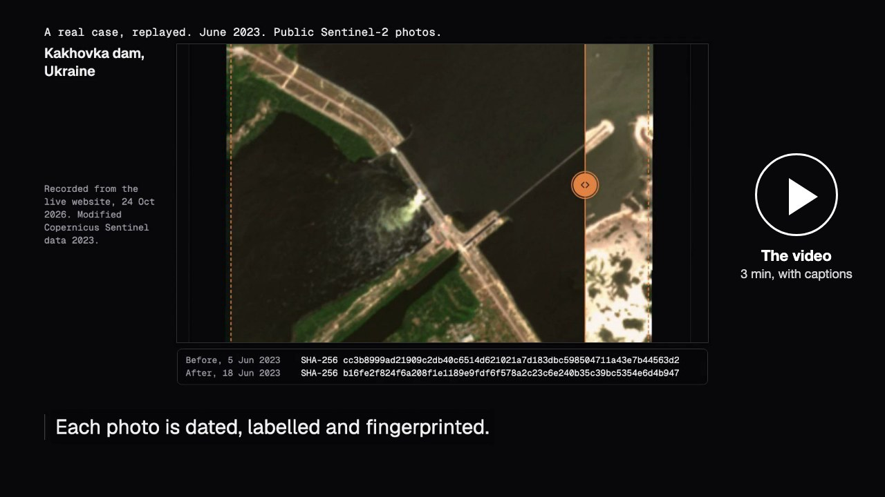
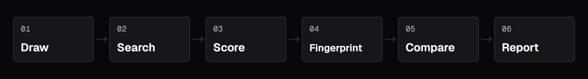

# GrahSaboot

**Free, dated satellite photos of any place, side by side, so you can check a claim about it yourself.** It shows you the photos and what a fixed rule measured in them. It never says whether a claim is true.

**Try it:** <https://grahsaboot.grahsaboot.workers.dev> (free, no sign-in)

> [!IMPORTANT]
> **What the photos cannot show.** One pixel covers 10 m by 10 m of ground, so a house is only 1 to 3 pixels. Clouds hide many dates, especially in the monsoon. The photos go back to 2017 only. The change rule (`change-v1`) is provisional and has not been validated: it cannot tell a building from a crop or a season. [Every limit](docs/guide.md#what-it-cannot-do)

[](docs/media/grahsaboot-explainer.mp4)

_The video takes 3 minutes. The captions are part of the picture, so it works with the sound off. GitHub does not play a video kept in a repository: the link opens the file's page, where Download saves it (7.3 MB)._

**Status on 24 October 2026:** a live, working prototype (version 0.1.0). Phases A to E are built and live. Accounts are built but switched off. Phase F is part built: its first stage has been live since 23 October 2026, and its time-lapse, "Watch it change", and a switch that hides the satellites since 24 October 2026. [Roadmap](docs/roadmap.md)

_Grah_ (ग्रह) means planet. _Saboot_ (सबूत) means proof.

## Why it is different

- **Evidence, not verdicts.** You look at dated photos and decide. The report says what a fixed rule measured, with its caution, and never whether your claim is true.
- **A report someone else can check.** Each photo's pixels get a SHA-256 fingerprint. The report lists the source file, the exact window read and the recipe versions, so anyone can read the same pixels later and compare.
- **The limits are up front.** The site has a limits page, warns you when an outline is too small for 10 m photos, and every report carries the limits with it.
- **Free, with no account.** The photos are public Sentinel-2 data. There is no sign-in, and your investigations stay in your browser.

Each part has earlier work behind it: the public Sentinel-2 archive, STAC photo catalogues, cloud masks and hashing. GrahSaboot puts them in one free place, around a report that another person can check.

## How it works



1. **Draw.** Pick a place on the globe and draw a site (an area) or a road (a line with a width).
2. **Search.** The site finds every Sentinel-2 photo that covers your outline in your dates.
3. **Score.** It reads only the pixels inside your outline and scores how much of it each photo sees clearly.
4. **Fingerprint.** It makes a SHA-256 fingerprint of those exact pixels.
5. **Compare.** You swipe between a "before" and an "after" photo, pin the dates that matter, and write notes and the claim you are testing.
6. **Report.** It saves one web page file with the photos, the dates, your notes, the limits, what a fixed rule measured, and where every pixel came from.

Everything runs in your browser. The only server is a small Cloudflare Worker that hands out the site and satellite orbit data. [How it works, with seven diagrams](docs/architecture.md)

## A worked example: the Navi Mumbai airport site

The site has one ready-made example, a 2 km square of land at the Navi Mumbai airport site.

1. Open the site and press **Try a worked example: Navi Mumbai airport**, or open [`/new?example=navi-mumbai-airport`](https://grahsaboot.grahsaboot.workers.dev/new?example=navi-mumbai-airport).
2. Open the workbench. It shows a clear photo from **22 February 2018** and one from **12 December 2025**. In both, 100% of the outline is in clear view.
3. Swipe between them. Then look at the timeline and the report.

On 24 October 2026 the report's "What we measured" block said this: between those two dates, the change rule found 10 changed patches of at least 0.3 ha and 30 m across, 21.4 ha in all, resting on 729,240 pixels that are clear in both photos. It cannot tell a building from a crop or a season, and the two dates are in different seasons, so seasonal change is included. You compare the photos by eye and decide.

## What you can do

- **Turn a 3D globe** with live satellites (Sentinel-2A, 2B and 2C, Landsat 8 and 9), their tracks and the strip of ground each one sees. An eye button hides them and remembers your choice.
- **Search for a place** by name or coordinates, and see when a satellite will next pass over it in daylight.
- **Start an investigation.** Draw a site or a road, choose dates, and open the workbench: swipe, side by side, or a brightness difference, with a timeline where a tall tick means a clear view.
- **Check a road in sections**, write notes and a claim, and **save a report** as one web page file.
- **Watch it change** (live since 24 October 2026). Six pictures of the same place, one a year and all from the same time of year, played one after another. They are for looking only: never saved, fingerprinted or put in a report. They load about 14 MB or more, which the button tells you first. While you wait, the start screen shows a small line drawing of six prints, which stays still if you have asked for less motion.
- **Look closer** (live since 23 October 2026). Once your outline is valid, two links open Google's Street View and Google Earth for its middle, in a new tab. GrahSaboot does not check those pages, and they never go in a report.
- **Sharper**, a viewing aid: the same pixels shown with a little more contrast and a light sharpening. It never changes a fingerprint or the report.

[](https://grahsaboot.grahsaboot.workers.dev)

[Everything it can do, in detail](docs/guide.md#what-you-can-do)

## What it cannot do

- **It cannot see small things.** At 10 m per pixel, large buildings, roads and cleared land show; a house is 1 to 3 pixels, and small or narrow things may not show.
- **Clouds get in the way.** A satellite passes every few days, but a pass is not always a usable photo.
- **"No visible change" does not mean "nothing happened".** Roofs hide what is inside, and work can happen between two photos.
- **It cannot show quality, payments, contracts or who did the work.**
- **The photos go back to 2017 only**, and pass times are estimates from public orbit data.
- **"Verified" has a narrow meaning.** The pictures match the public source file at the time of checking. That proves no claim about a project.
- **The change rule is provisional** and has not been validated, and the uses suggested here have not been tested with real users.
- **Size limits.** A site can be up to 9 km²; a road up to 10 km long, checked in 2 km sections.

The full list is in the [guide](docs/guide.md#what-it-cannot-do) and on the site at `/limits`.

## Accessibility and privacy

- Every screen is tested with axe against WCAG 2.2 AA, in the dark and the light theme. The site works with a keyboard, focus is visible, and status messages are read out by screen readers.
- Reduced motion is respected. Photo-quality labels use a symbol and a word, never colour alone.
- The live site has no accounts and no database. Your investigations and your theme choice stay in your browser.
- Place searches go to OpenStreetMap Nominatim only when you press Search. Maps, globe pictures and photos come straight from public services, which see your IP address and the area you look at, never your name or email. Nothing goes to Google until you click a Look closer link. Cloudflare, which hosts the site, sees ordinary request information, and the Worker's logs are switched on.

More in [Accessibility](docs/guide.md#accessibility) and [Privacy and security](docs/privacy-and-security.md).

## Run it on your computer

You need Node.js 22.12 or newer, and npm. No keys or settings are needed.

```bash
npm ci          # installs the exact packages listed in package-lock.json
npm run dev     # opens the site at http://localhost:5173
npm run check   # the full gate: types, tests, three builds, size and security guards
```

`npm run dev` has no Worker, so satellite positions come from the saved copy in `public/tle-snapshot.json`. Every command, setting and check is in [the development guide](docs/development.md).

## Documentation

| Where                                                                                                    | What is in it                                                                                                      |
| -------------------------------------------------------------------------------------------------------- | ------------------------------------------------------------------------------------------------------------------ |
| [`docs/guide.md`](docs/guide.md)                                                                         | Everything you can do, every limit, the worked example, what the report measures, accessibility, Q and A, glossary |
| [`docs/architecture.md`](docs/architecture.md)                                                           | How it works: seven diagrams with their Mermaid source, the services, the pages, device levels, the code map       |
| [`docs/privacy-and-security.md`](docs/privacy-and-security.md)                                           | What the site does with your data, and how it is kept safe                                                         |
| [`docs/development.md`](docs/development.md)                                                             | Running it, commands, settings, the checks and what they held, deploying, accounts (built, switched off)           |
| [`docs/roadmap.md`](docs/roadmap.md)                                                                     | The phases: what is live, what is built, what is planned                                                           |
| [`docs/ops/deploy.md`](docs/ops/deploy.md)                                                               | How to publish, the smoke checklist, rollback, logs, the deploy record                                             |
| [`docs/ops/runbook.md`](docs/ops/runbook.md)                                                             | Operations guide. Anything touching Supabase, Cloudflare or Google is run by the owner only                        |
| [`docs/ops/accounts.md`](docs/ops/accounts.md), [`docs/ops/accounts-test.md`](docs/ops/accounts-test.md) | How accounts work and how to test and switch them on                                                               |
| [`docs/ops/probes.md`](docs/ops/probes.md)                                                               | A log of measured experiments (speed, browsers, photo reading) and what was decided                                |
| [`docs/design/README.md`](docs/design/README.md)                                                         | The approved visual direction and mockups                                                                          |
| `docs/designs/`, `docs/superpowers/`                                                                     | Design notes, plans and specs for each phase                                                                       |
| `docs/geoverify/`                                                                                        | Older product notes from when the idea was called GeoVerify                                                        |
| `docs/screenshots/`, `docs/media/`                                                                       | Screenshots, the video and its poster                                                                              |

## Help, contributing and licence

- **Questions and bug reports:** open an issue on the GitHub project (`Krishpotanwar/grahsaboot`) or contact the owner, Krish Potanwar.
- **Contributing:** there is no contribution guide yet. If you want to help, contact the owner first.
- **Security:** no public security contact is set up yet. Please contact the owner directly.
- **Licence:** no licence file has been chosen yet. The owner has not decided whether to open the code. Until a licence is published, please treat the code as not free to copy or reuse, and ask first.

## Data and credits

- **Photos:** contains modified Copernicus Sentinel data. Photos are found through Earth Search (run by Element 84) and Microsoft Planetary Computer, and read from public Sentinel-2 files on AWS and Azure.
- **Globe pictures:** NASA GIBS, Blue Marble.
- **Maps:** map data © OpenStreetMap contributors; styles by OpenFreeMap and OpenMapTiles.
- **Place search:** OpenStreetMap Nominatim.
- **Orbit data:** CelesTrak.
- **Terrain:** AWS Terrain Tiles.
- **Fonts:** Geist and Geist Mono.
- **Line drawing:** the six-print drawing on the time-lapse start screen runs on the Hairline engine by Lucas Marques (MIT licence), kept unchanged in `src/lib/hairline/` with its licence text.
- **Code libraries:** open-source packages listed in `package.json`, each under its own licence.

## How it was built

Krish Potanwar built GrahSaboot in phases, starting on 5 October 2026. An AI coding assistant implemented the plan under his direction, and every task had to end with the automatic checks passing.
