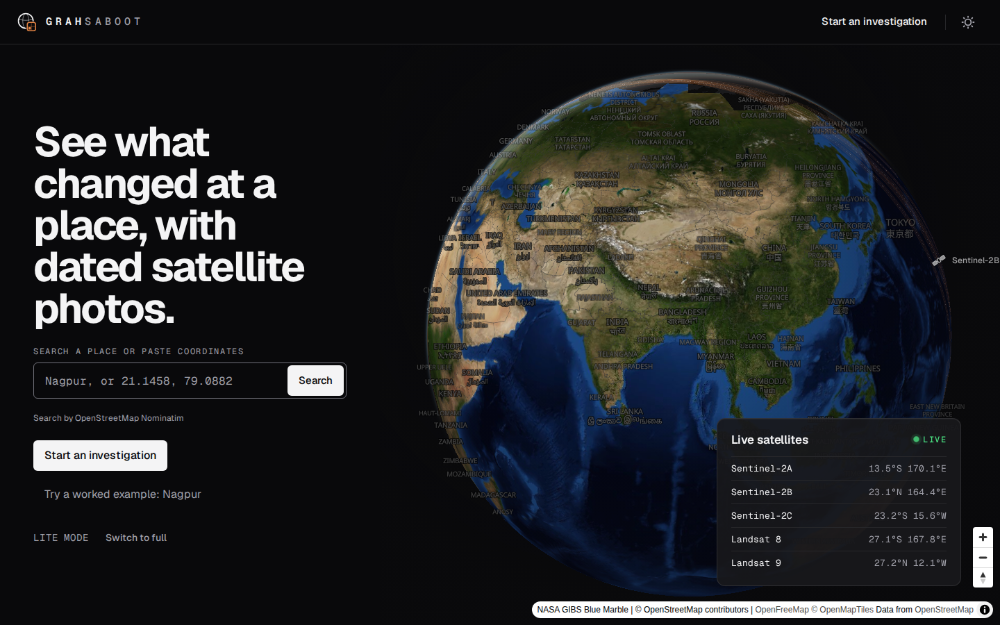
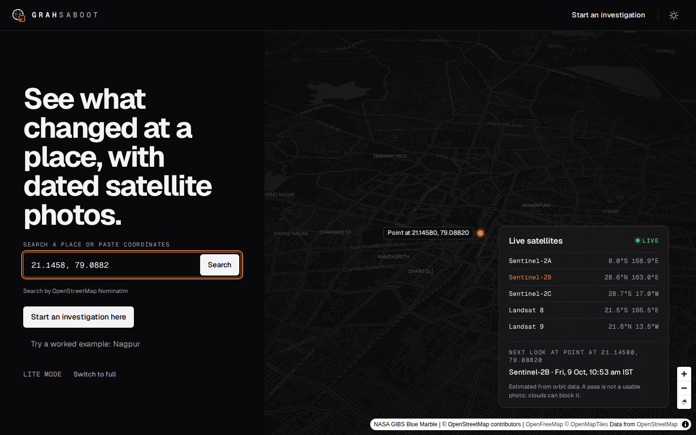
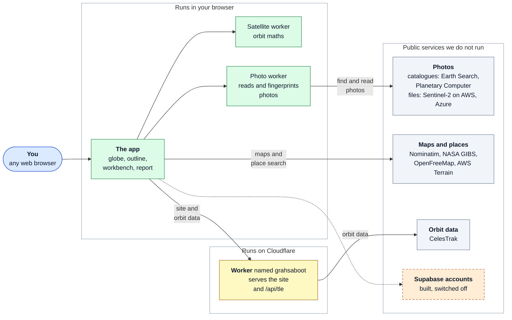
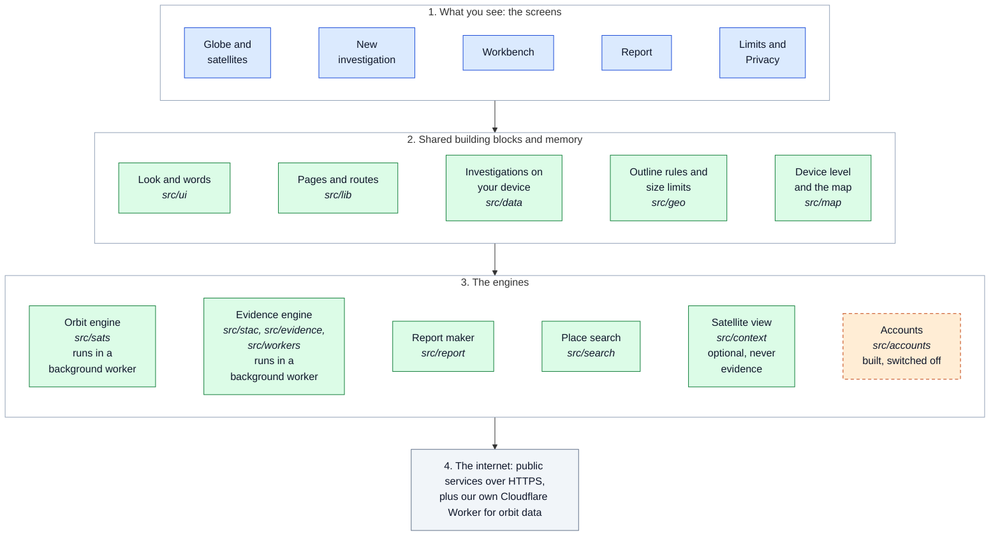
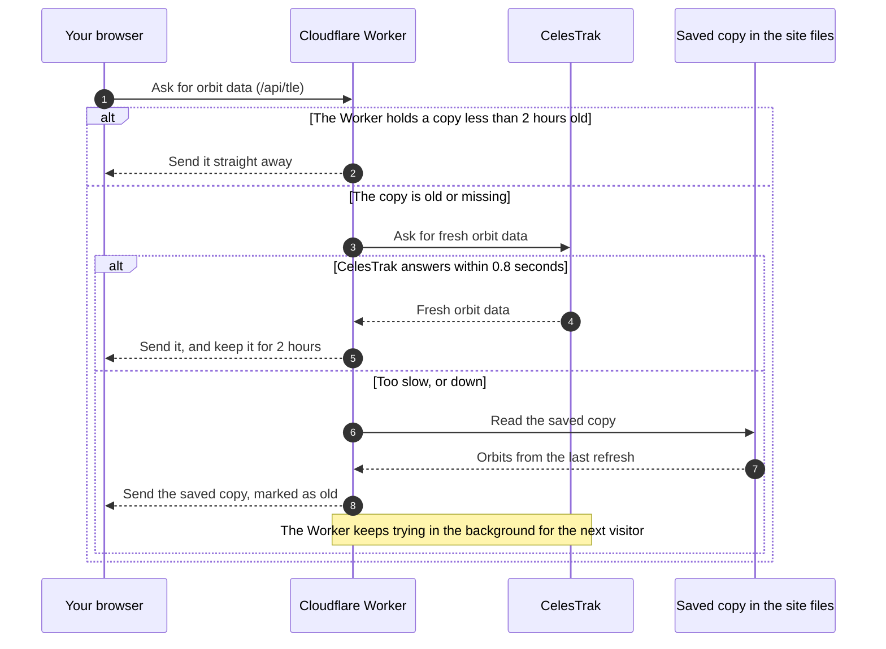
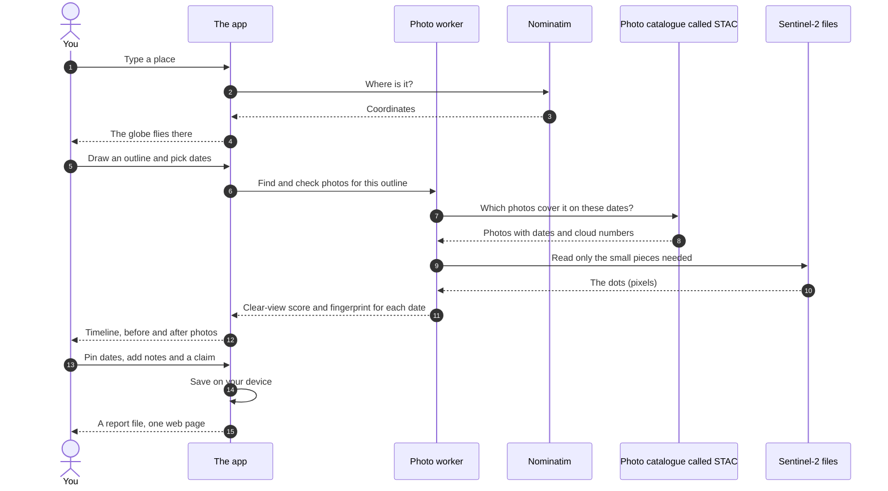
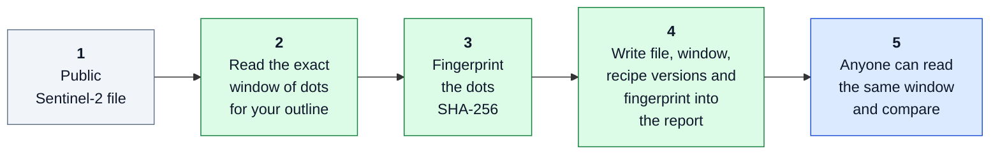
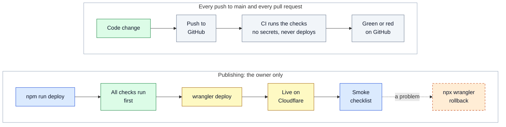
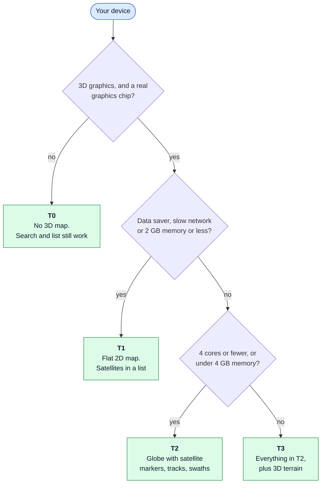

# GrahSaboot

**Satellite proof for any place.**
_Grah_ (ग्रह) means planet. _Saboot_ (सबूत) means proof.

[](https://grahsaboot.grahsaboot.workers.dev)

**Try it now:** <https://grahsaboot.grahsaboot.workers.dev> (free, no sign-in)

> **Status:** a live, working prototype (version 0.1.0). Phases A to E are built and live. Accounts are built but switched off. Phase F is part built: the Look closer box, a Sharper viewing aid, a faster photo reader and a "What we measured" block in the report are built and merged, and wait for the owner to deploy them. The time-lapse is not built. See the [Roadmap](#roadmap).

## Contents

- [In one minute](#in-one-minute)
- [What you can do](#what-you-can-do)
- [What it cannot do](#what-it-cannot-do)
- [A worked example](#a-worked-example)
- [How it works](#how-it-works)
- [Architecture](#architecture)
- [The pages of the website](#the-pages-of-the-website)
- [Built with](#built-with)
- [Where things are](#where-things-are)
- [Run it on your computer](#run-it-on-your-computer)
- [Settings](#settings)
- [Checks that keep it safe](#checks-that-keep-it-safe)
- [Putting it online (deploy)](#putting-it-online-deploy)
- [Security](#security)
- [Privacy](#privacy)
- [Speed and different devices](#speed-and-different-devices)
- [Accessibility](#accessibility)
- [Accounts (built, switched off)](#accounts-built-switched-off)
- [Roadmap](#roadmap)
- [Documents](#documents)
- [Questions and answers](#questions-and-answers)
- [Glossary](#glossary)
- [Data and credits](#data-and-credits)
- [Help, contributing and licence](#help-contributing-and-licence)
- [How it was built](#how-it-was-built)

---

## In one minute

GrahSaboot is a free website. You pick a place on a globe. It finds real photos of that place taken from space. It checks which photos are clear and which are hidden by clouds. You put a "before" photo next to an "after" photo and look for yourself. When you are done, it writes a **report** you can save and share.

The report lists exactly which photos were used. Each photo gets a **digital fingerprint**, so anyone can check later that the photos were not changed.

**Why does it exist?** People say things like "this road was built last year" or "that building is finished". Checking is hard and often costs money. GrahSaboot lets anyone look at free, public satellite photos, with the date on every photo. It is also honest about what the photos can and cannot show.

**Where do the photos come from?** From **Sentinel-2**, three European satellites (Sentinel-2A, 2B and 2C) that photograph all of the Earth's land every few days. The photos are free and open. One dot (pixel) in a photo covers 10 metres by 10 metres of ground.

**Who is it for?** Anyone who wants to check a claim about a place, for example "work started on this site in 2022" or "a new road was built here", without paying for pictures or learning special software.

## What you can do

- **Turn a 3D globe.** It shows a real picture of the Earth. On a big screen it turns slowly by itself. There is a dark theme (the default) and a light theme.
- **See live satellites.** Sentinel-2A, 2B and 2C, plus Landsat 8 and 9, move on the globe in real time. Each one shows its name, its path (a dashed line) and the strip of ground it can see (its "swath").
- **Search for a place** by name, or type coordinates such as `21.1458, 79.0882`. The globe flies there and drops a pin. If you type Indian coordinates the wrong way round, the site offers a one-tap fix.
- **See the next pass.** For your place, it estimates when a satellite will next fly over in daylight.
- **Start an investigation.** Pick a place, draw an outline of a site (a plot, a building) or a road on the map (or paste coordinates), choose the dates, check, and open it.
  - The map stays readable while you draw. You can undo corners. A size note tells you when what you drew is too small for 10 m photos to show.
  - **An optional satellite view** can sit behind the map to help you find your place. It is one recent photo, it only loads when you switch it on, it tells you how old it is, and it is never used as evidence.
- **Use the workbench.** Compare a "before" and an "after" photo with a swipe, side by side, or as a brightness difference. A small map shows your outline. Each photo shows its date, the satellite, how much of your outline it sees clearly, and its fingerprint.
- **Use the timeline.** Every satellite pass in your date range is a tick. A tall tick means a clear view. A short tick means clouds hide the view. Press or drag along it to move through the dates, and pin the dates that matter.
- **Check a road in sections.** A road is cut into sections. A grid shows how clearly each section is seen on each pinned date.
- **Write notes and a claim.** Say what you see, and what claim you are testing.
- **Save a report.** One self-contained web page file with the photos, the table of dates, your notes and claim, the limits, and a "provenance" block (a list of every file, window and fingerprint used) so someone else can check your work.
- **Phase F so far (built and merged, waiting to be deployed).**
  - **Look closer.** Once your outline is valid, a box offers two links, Street View and Google Earth. It sits in the outline step and at the top of the workbench. Each link opens Google's own page for the middle of your outline in a new tab. GrahSaboot does not check those pages, and they are never put in a report. In the notes panel, a button starts a note with "Street View, " and leaves the date for you to type from what Google shows.
  - **Sharper.** A switch in the workbench's tool row shows the photos with a little more contrast and a light sharpening. It is "a viewing aid: the same pixels, shown more clearly". It starts off at every visit, and it never changes a fingerprint or the report.
  - **What we measured.** The report gets a short block with a changed area in hectares, or a plain statement of why it has none. See [What the report measures](#what-the-report-measures).
  - **Smaller changes.** Photo files are read in 16 KB blocks. For a 1 km square, with nothing cached, a cloud check or a photo now takes 2 requests on Earth Search where it took 12 to 14, and the pixels and fingerprints are the same (measured in [`docs/ops/probes.md`](docs/ops/probes.md), P18, which also gives the times and their limits). A date that is not a real day, such as 30 February, is shown as written instead of as another day. If a tab was left open across an update and a page will not load, the tab reloads itself once to get the new files.

Your investigations stay in your browser, on your device. There are no accounts on the live site.



## What it cannot do

Please read this part. It is the most important part.

- **It cannot see small things.** Photos are 10 metres per pixel. A house is only one to three dots. Large buildings, roads and cleared land can be seen. Small or narrow things may not be.
- **Clouds get in the way.** Clouds often block the view, especially in the monsoon. A satellite passes every few days, but a pass is not always a usable photo.
- **"No visible change" does not mean "nothing happened".** Roofs hide what is inside, and work can happen between two photos.
- **It cannot show quality, payments, contracts or who did the work.**
- **Photos go back to 2017 only.**
- **Pass times are estimates.** They are worked out from public orbit data.
- **The satellite view is for finding your place.** It is not saved, not fingerprinted and never put in a report.
- **"Verified" has a narrow meaning.** It means the pictures match the public source file at the time of checking. It does not prove any claim about a project.
- **Size limits.** A site can be up to 9 km² and 4.25 km across. A road can be up to 10 km long and 5 to 200 metres wide. Roads are checked in 2 km sections.

The full list is on the website at `/limits`.

## A worked example

The site has one ready-made example: the **Navi Mumbai airport site**, a 2 km square of land.

1. Open the website.
2. Press **Try a worked example: Navi Mumbai airport**.
3. Open the workbench. It shows a clear photo from **22 February 2018** and a clear photo from **12 December 2025**.
4. Swipe between them. Then look at the timeline and the report.

Direct link: `/new?example=navi-mumbai-airport`.

## How it works

The story in five steps:

1. **You choose a place.** You search by name or type coordinates.
2. **You draw an outline.** It can be a site (an area) or a road (a line with a width).
3. **You choose dates.** The site looks for every satellite photo that covers your outline in that time.
4. **The site checks each photo.** It reads only the small piece of each photo file that covers your outline. It scores how clear the view is, and it makes a fingerprint of those exact dots.
5. **You compare and write the report.** You pin the dates that matter, add notes and a claim, and save the report.

### What the report measures

This part is built and merged, and waits for the owner to deploy it.

The Evidence part of the report ends with a short block called **What we measured**. A fixed rule, `change-v1`, compares your two pinned photos (the "before" and the "after"). It looks for patches of changed ground that are at least 0.3 ha (a hectare is 100 m by 100 m) and 30 m across. Those settings are provisional. The block says what the rule found, in one of five ways:

- **A changed area** in hectares, always with the caution "It cannot tell a building from a crop or a season: compare the pictures by eye."
- **No changed patch** of that size.
- **Most of the picture differs**, so the rule "cannot separate a change from a difference in overall brightness or colour". It states no area.
- **Not enough ground:** "Not enough clear ground in both pictures to compare."
- **An outline that is too small** to hold a patch of that size.

The numbers are computed from the pixels, not seen by a person, and the block never says whether your claim is true. If it compared the photos and the two dates are more than 20 days apart in the year, it adds "These dates are in different seasons; seasonal change is included." It records the rule, the grid and the settings, so it can be run again from the hashed source pixels. It appears only when the rule could run. If it could not (a photo has no cloud check, or no answer comes within 10 seconds, for example), the report is made without it. The report's provenance names `change-v1` only when the block is there.

## Architecture

This section shows the same system from five angles. Each diagram answers one question.

| Question                                                  | Diagram                                                                                              |
| --------------------------------------------------------- | ---------------------------------------------------------------------------------------------------- |
| Who talks to whom?                                        | [1. The big picture](#1-the-big-picture)                                                             |
| How is the code organised?                                | [2. Inside the app: the layers](#2-inside-the-app-the-layers)                                        |
| Where do the satellite positions come from?               | [3. Satellite positions and the Cloudflare Worker](#3-satellite-positions-and-the-cloudflare-worker) |
| What happens between typing a place and getting a report? | [4. From a place to a report](#4-from-a-place-to-a-report)                                           |
| Why can someone else trust a report?                      | [5. How a photo becomes evidence](#5-how-a-photo-becomes-evidence)                                   |

Two more diagrams sit next to the text they explain: [which version of the site your device gets](#speed-and-different-devices) and [how a change goes live](#putting-it-online-deploy).

The diagrams are drawn with Mermaid, which GitHub shows as pictures. **Colour key:** blue is you and the screens, green is our code that runs in your browser, yellow is our server on Cloudflare, grey is a public service we do not run, and orange with a dashed edge is built but switched off.

### 1. The big picture



Only one thing runs on our side: a small Cloudflare **Worker**. It hands out the website and one route, `/api/tle`, that serves satellite orbit data. Everything else happens in your browser, and your browser talks straight to public services:

| Service                                                    | What we use it for                                                               |
| ---------------------------------------------------------- | -------------------------------------------------------------------------------- |
| Earth Search (Element 84) and Microsoft Planetary Computer | Searching for satellite photos (the catalogue). Planetary Computer is the backup |
| Sentinel-2 files on AWS and Azure                          | The photos themselves, read in small pieces                                      |
| OpenStreetMap Nominatim                                    | Place search                                                                     |
| NASA GIBS                                                  | The picture of the Earth on the globe                                            |
| OpenFreeMap                                                | The flat map: roads, labels, building outlines                                   |
| AWS Terrain Tiles                                          | 3D terrain (top device level only)                                               |
| CelesTrak                                                  | Satellite orbit data, through our Worker                                         |
| Supabase                                                   | Accounts (built, switched off)                                                   |

### 2. Inside the app: the layers



Each layer relies on the layer below it. Two walls are checked by automatic tests: the optional satellite view (`src/context`) never feeds a report, and the accounts code (`src/accounts`) can only be reached through one switch.

### 3. Satellite positions and the Cloudflare Worker



Your browser works out where each satellite is by itself, using orbit data. The Worker's only job is to fetch that orbit data from CelesTrak, keep it for 2 hours, and never make you wait: if CelesTrak is slow it sends the saved copy at once.

### 4. From a place to a report



### 5. How a photo becomes evidence



A fingerprint (a "hash") is a short code worked out from the dots. If even one dot changed, the code would be completely different. That is how a reader can tell the photos in a report are the real ones.

Every calculation has a version name, for example `scl-v2` for the cloud scoring and `diff-v1` for the brightness difference. The report lists them, so a later reader knows exactly which maths was used. The optional satellite view and the preview pictures are never saved, fingerprinted or put in a report.

## The pages of the website

| Address          | What it is                                                         |
| ---------------- | ------------------------------------------------------------------ |
| `/`              | The globe: live satellites, place search, next pass                |
| `/new`           | Start an investigation: place, outline, dates, review              |
| `/i/<id>`        | The workbench for one investigation                                |
| `/i/<id>/report` | The report for that investigation                                  |
| `/limits`        | What the photos can and cannot show                                |
| `/privacy`       | What the site does with your data                                  |
| `/dev/kit`       | A page for developers that shows the building blocks of the design |
| `/api/tle`       | The only server route: satellite orbit data                        |

## Built with

| Part          | What we use                                               | What it does for you                                                                |
| ------------- | --------------------------------------------------------- | ----------------------------------------------------------------------------------- |
| The app       | React 19, TypeScript 7, Vite 8                            | Draws the screens, catches mistakes while code is written, builds the website files |
| Looks         | Tailwind CSS 4, Geist fonts, Base UI, Phosphor icons      | Colours, spacing, text, accessible building blocks, icons                           |
| Map and globe | MapLibre GL 6.12, terra-draw 1.36                         | Draws the 3D globe and the flat map, and lets you draw an outline                   |
| Orbits        | satellite.js 7.1                                          | Works out where satellites are from public orbit data                               |
| Photos        | geotiff 3, proj4 2.22                                     | Reads pieces of satellite photo files and converts between map systems              |
| Server        | Cloudflare Workers, Wrangler 4                            | Hands out the site and the `/api/tle` route (free plan)                             |
| Tests         | Vitest 5, Playwright 1.63 with axe-core, Deno 2.9, PGlite | Check the code, real browsers, accessibility, server functions and database rules   |
| Later (off)   | Supabase                                                  | Accounts (see [Accounts](#accounts-built-switched-off))                             |

Every package version is pinned exactly in `package.json`, and `package-lock.json` is committed, so a fresh install gives the same result.

## Where things are

```
src/
  app.tsx, main.tsx   routes and the app entry
  config.ts           the web addresses of every service it uses
  styles.css          colours and themes (dark and light)
  screens/            the pages: globe, new investigation, workbench, report, limits and privacy, the design kit, not found
  ui/                 design building blocks, the shell, search box, satellites panel; copy.ts holds the words on screen
  map/                the persistent MapLibre globe, device levels, camera, satellite layers
  sats/               satellite list, orbit maths, next-pass search (in a background worker)
  search/             the Nominatim client (throttled, cached)
  evidence/           the evidence engine: photo pieces, SHA-256, cloud scores, shared grid, difference
  stac/               Sentinel-2 photo search (Earth Search, with Planetary Computer as backup)
  workers/            the photo-reading background worker
  context/            the optional satellite view (an aid for finding a place, never evidence)
  geo/                coordinates and outline limits
  new/                the "new investigation" steps: place, outline, dates, review
  workbench/          the workbench: viewer, timeline, road grid, notes, claim
  report/             the report: HTML, provenance, safe escaping of text
  data/               the investigation model and the on-device store
  lib/                small helpers (router, caching of photo pieces, formatting)
  accounts/           sign-in, save and verify (built, switched off, reached through one flag)
  explore/            the same-season picker and the share link: Phase F building blocks, not on a screen yet
worker/               the Cloudflare Worker: /api/tle with cache, back-off and saved-copy fallback
supabase/             database migrations and the verify and delete-account functions (not live)
scripts/              the checks run by npm run check, the headers builder, probes, the orbit snapshot tool
dev/                  a page the live checks open to read one photo window in a real browser
public/               icons and tle-snapshot.json
tests/                unit, db (database), e2e (browser), live (real services), fixtures, accounts
docs/                 design mockups, plans, research, probes and operations guides
```

## Run it on your computer

**You need:** Node.js 22.12 or newer, and npm (it comes with Node).

```bash
npm ci               # installs the exact packages listed in package-lock.json
npm run dev          # opens the site at http://localhost:5173
```

- `npm run dev` has no Worker. The satellite positions come from the saved copy in `public/tle-snapshot.json`, and nothing calls CelesTrak.
- To try the real `/api/tle` route, run `npm run build && npx wrangler dev`. (`npm run preview` also has no Worker.)

### The commands you will use

| Command                                      | What it does                                                                                                                                         |
| -------------------------------------------- | ---------------------------------------------------------------------------------------------------------------------------------------------------- |
| `npm run dev`                                | Starts the development site                                                                                                                          |
| `npm run build`                              | Builds the website into `dist/` and writes the security headers                                                                                      |
| `npm run preview`                            | Shows the built site locally (no Worker)                                                                                                             |
| `npm run typecheck`                          | Checks the TypeScript code for mistakes                                                                                                              |
| `npm test`                                   | Runs the unit and database tests                                                                                                                     |
| `npm run check`                              | Runs everything above plus the safety guards on three builds (the full gate)                                                                         |
| `npm run e2e`                                | Runs the browser tests with fake data. Pick browsers with `E2E_BROWSERS=chromium,firefox`. First time: `npx playwright install --with-deps chromium` |
| `npm run e2e:live`                           | Runs browser tests against the real services                                                                                                         |
| `npm run check:deno` and `npm run test:deno` | Check and test the server functions (they use Deno)                                                                                                  |
| `npm run bundle` and `npm run csp`           | Run one guard on its own (size budget, security policy)                                                                                              |
| `npm run sync:evidence`                      | Copies the evidence code into the server functions' folder                                                                                           |
| `npm run tle:snapshot`                       | Refreshes the saved orbit copy. At most once every 2 hours                                                                                           |
| `npm run probe`                              | Reads one real photo window and prints its fingerprint (used to compare different runtimes)                                                          |
| `npm run fmt`                                | Tidies the code layout with Prettier                                                                                                                 |
| `npm run deploy`                             | Runs `npm run check`, then publishes (owner only)                                                                                                    |

## Settings

You do **not** need any settings to run the site. Every service address has a public default in `src/config.ts`. You can change any of them with a `VITE_*` variable in your shell or an env file.

| Variable                              | What it changes                                                            | Default                                       |
| ------------------------------------- | -------------------------------------------------------------------------- | --------------------------------------------- |
| `VITE_STAC_URL`                       | The photo catalogue                                                        | Earth Search                                  |
| `VITE_PC_STAC_URL`, `VITE_PC_SAS_URL` | The backup catalogue (Planetary Computer) and its access-token address     | Planetary Computer                            |
| `VITE_NOMINATIM_URL`                  | Place search                                                               | OpenStreetMap Nominatim                       |
| `VITE_TLE_URL`                        | Where orbit data comes from                                                | `/api/tle` (in `npm run dev`: the saved copy) |
| `VITE_STYLE_DARK`, `VITE_STYLE_LIGHT` | The map drawing styles                                                     | OpenFreeMap dark and positron                 |
| `VITE_GIBS_TILES`                     | The globe pictures                                                         | NASA GIBS Blue Marble                         |
| `VITE_TERRAIN_TILES`                  | 3D terrain                                                                 | AWS Terrain Tiles                             |
| `VITE_CONTEXT_IMAGERY=0`              | Builds the site **without** the satellite view (`npm run build:nocontext`) | on                                            |

Accounts have their own settings (`VITE_ACCOUNTS`, `VITE_SUPABASE_URL`, `VITE_SUPABASE_PUBLISHABLE_KEY`, and tooling secrets). They are explained in `.env.example` and are only for developers testing accounts. Real secrets must never be committed (the real `.env*` files are git-ignored). `npm run env:check` checks the pair of files.

## Checks that keep it safe

`npm run check` is the full gate. GitHub runs it for every push to `main` and every pull request, with the extra steps described under the table.

| Check                 | What it protects                                                                                  | How to run it                             |
| --------------------- | ------------------------------------------------------------------------------------------------- | ----------------------------------------- |
| Type check            | Catches mistakes before the code runs                                                             | `npm run typecheck`                       |
| Unit tests            | Small pieces of logic behave as intended                                                          | `npm test`                                |
| Database tests        | The rules of the accounts database (run in memory, nothing real is touched)                       | part of `npm test`                        |
| Three builds          | The normal build, a build with accounts (for testing only) and a build without the satellite view | part of `npm run check`                   |
| Size budget           | The first page loads at most 150 KB of JavaScript (compressed)                                    | `npm run bundle`                          |
| Accounts guard        | The normal build holds no accounts code, words or storage keys                                    | `npm run bundle`                          |
| Security policy check | Every web address the code uses is listed, with no wildcards and no `unsafe-eval`                 | `npm run csp`                             |
| Evidence copy check   | The server's copy of the evidence code matches the browser's                                      | `npm run sync:evidence`                   |
| Server function tests | The (switched-off) server functions type-check and pass tests in Deno                             | `npm run check:deno`, `npm run test:deno` |
| Browser tests         | Real browsers walk through the main flows with fake data                                          | `npm run e2e`                             |
| Accessibility tests   | Every screen passes axe (WCAG 2.2 AA) in both themes                                              | part of `npm run e2e`                     |
| Live checks           | The same flows against the real services, including photo fingerprints                            | `npm run e2e:live`                        |

CI (`.github/workflows/ci.yml`) uses Node 22. It holds **no secrets** and **never deploys**. It runs `npm run check`, a check that the server's evidence copy is committed, the Deno checks and tests, and the browser tests in Chromium (the desktop, phone-sized and accounts projects). It does not run the live checks, Firefox or WebKit: those are run by hand.

**What the checks held at this release.** All 1,542 unit tests (95 files, the database tests among them) and all 62 server-function tests in Deno pass. More than 600 browser tests pass in Chromium, a phone-sized Chromium and the accounts build, and more than 270 pass in WebKit; a few more skip themselves by design (a touch test on a desktop browser, for example). The first page's JavaScript is just under 100 KB compressed, inside the 150 KB limit.

## Putting it online (deploy)

The site runs on **Cloudflare Workers** (free plan) as a Worker named `grahsaboot`. It is not on Vercel.

```bash
npm run tle:snapshot   # optional: refresh the saved orbits, at most once every 2 hours
npm run deploy         # runs npm run check, then wrangler deploy
```



- Only the owner deploys. Pushing to GitHub deploys nothing.
- `npm run deploy` always publishes the build **without** accounts.
- After a deploy, run the smoke checklist in [`docs/ops/deploy.md`](docs/ops/deploy.md). If something is wrong: `npx wrangler rollback`.
- Logs: `npx wrangler tail grahsaboot`. Observability is switched on.
- The build writes `dist/_headers` (the security policy and headers) from the list of web addresses the code really uses (`scripts/csp.ts`). `npm run check` holds that file to the rules.

## Security

- **No secrets in the browser.** The site needs no keys. Service addresses are public.
- **A strict content security policy.** It is generated from the exact list of hosts the code talks to. It allows no wildcards and no `unsafe-eval`. The one inline script (the theme switch) is allowed by its fingerprint, calculated from the built page.
- **Safe server route.** `/api/tle` accepts only GET and HEAD, anything else gets a 405. Unknown `/api/*` routes get a plain JSON 404. Responses carry `X-Content-Type-Options: nosniff`.
- **Inputs are checked.** Outlines, widths, dates and coordinates are validated against clear limits before use.
- **Reports escape text.** Whatever you type in a note or claim is escaped before it goes into the report page.
- **Nothing to steal on the server.** The live site has no accounts and no database. The Worker has no secrets and no variables.
- **Pinned packages.** Every dependency version is exact, and the lock file is committed.
- **Accounts stay off by default.** A guard fails the build if accounts code appears in the normal build.
- **Reporting a problem.** No public security contact is set up yet. Please contact the owner directly (see [Help, contributing and licence](#help-contributing-and-licence)).

## Privacy

- **No accounts and no database** on the live site. Your investigations and your theme choice stay in your browser.
- **Place searches** go to OpenStreetMap Nominatim, only when you press Search (at most once a second).
- **Map and globe pictures** come from OpenFreeMap, NASA GIBS and AWS. Those requests reveal your IP address and the area you are looking at.
- **Satellite photos** are read straight from public Sentinel-2 files on Amazon Web Services (with Microsoft's Planetary Computer and Azure as backup). Those requests reveal an approximate area, never your name or email.
- **The satellite view** is off until you switch it on. A choice you made earlier is remembered and starts it again by itself. It asks the Earth Search catalogue about a coarse version of your map area and reads one recent photo.
- **The Look closer links** (built and merged, not yet deployed) open Google Street View and Google Earth in a new tab. Nothing is sent to Google until you click one. A click sends the middle of your outline, as latitude and longitude, to Google; what Google does with it is set by its own privacy policy.
- **Satellite positions** come through our Worker from CelesTrak. Nothing about you is sent to CelesTrak.
- **Our host.** Cloudflare, which hosts the site, can see ordinary web request information, and the Worker's logs are switched on.

The short version is on the website at `/privacy`.

## Speed and different devices

The site checks your device and picks one of four levels:

| Level | When                                                             | What you get                                        |
| ----- | ---------------------------------------------------------------- | --------------------------------------------------- |
| T0    | No WebGL2 (3D graphics), or a software graphics chip             | No 3D map. Search and the satellite list still work |
| T1    | Data saver, a slow network (2G or 3G), or 2 GB of memory or less | A flat 2D map. Satellites are listed in the panel   |
| T2    | 4 cores or fewer, or less than 4 GB of memory                    | The globe with satellite markers, tracks and swaths |
| T3    | Everything else                                                  | All of T2, plus 3D terrain                          |

On T1 and T2 you can press "Switch to full". The choice is made in this order:



How it stays fast:

- **A small first page.** The JavaScript for the first screen is held to 150 KB compressed. Every other screen is loaded only when you open it (the big map library is its own file, by design).
- **Small reads.** The site reads only the pieces of each photo file that cover your outline, not the whole file.
- **Remembering.** Recently read pieces are kept in your browser so a second look is quick.
- **Background workers.** Orbit maths and photo reading run off the main screen thread, so the page stays smooth.
- **Server cache.** The Worker keeps orbit data for 2 hours. If CelesTrak does not answer within 0.8 seconds, it sends a saved copy right away, and the refresh finishes in the background.

## Accessibility

- Every screen is tested with axe against **WCAG 2.2 AA**, in both the dark and the light theme.
- You can use the site with a keyboard. Focus is visible, and status messages are read out by screen readers.
- **Reduced motion** is respected (the globe stops turning by itself).
- The photo-quality labels never rely on colour alone: each one uses a symbol and a word. In high-contrast (forced colours) mode, the timeline marks switch to system colours.
- The weakest devices (T0) get a simple version that still works.

## Accounts (built, switched off)

Sign-in with Google, saving, and a server re-check of every photo are written and tested. They sit behind a build flag. A normal build holds **no** accounts code, words, requests or storage keys, and a guard in `npm run check` proves that every time. The owner switches accounts on only after a tester has tried them on a development project ([`docs/ops/accounts-test.md`](docs/ops/accounts-test.md)). `npm run deploy` never ships them. The live site has no accounts.

## Roadmap

| Phase              | Status                 | What it delivers                                                                                                                                 |
| ------------------ | ---------------------- | ------------------------------------------------------------------------------------------------------------------------------------------------ |
| A: Foundation      | Done                   | Tools, geometry, the evidence engine (photo pieces, fingerprints, cloud scores, shared grid, difference), photo search, the photo-reading worker |
| B: Shell and globe | Done, live             | Design system, pages and navigation, the globe with device levels, place search, live satellites, next pass                                      |
| C: Workbench       | Done, live             | New investigation, the workbench (swipe, side by side, difference), timeline, road sections, notes, report export                                |
| D: Accounts        | Built, switched off    | Google sign-in, saving, a server re-check of every photo, privacy controls                                                                       |
| E: Clear imagery   | Done, live             | A readable outline map in both themes, drawing aids, a size note, an optional recent satellite photo behind the map                              |
| F: Look closer     | **Part built, merged** | See below                                                                                                                                        |

**Phase F, in plain words.** The aim is to type a place and watch a time-lapse of the same time of year across the last six years, one photo per year. Part of it is built and merged, and waits for the owner to deploy it. The time-lapse itself is not built.

- **Built and merged:** the Look closer box (Street View and Google Earth links, and a button that starts a Street View note), the Sharper viewing aid, a faster photo reader, two small fixes (dates, and a tab left open across an update), and the "What we measured" block in the report.
- **Building blocks:** the change rule, the same-season picker and the share-link codec are built and tested as building blocks, but only the change rule has a place on a screen so far (the "What we measured" block), and the other two have none.
- **Not built:** the time-lapse itself (its loader, player and page, and the plain line it will show when 10 m photos cannot support a claim), the gallery of real big changes, a share link you can use, and the hand-over of two photos from the time-lapse into a full investigation. What is not built is a plan that may change, not a promise.

## Documents

| Where                                                                                                    | What is in it                                                                               |
| -------------------------------------------------------------------------------------------------------- | ------------------------------------------------------------------------------------------- |
| [`docs/ops/deploy.md`](docs/ops/deploy.md)                                                               | How to publish, the smoke checklist, rollback, logs, the deploy record                      |
| [`docs/ops/runbook.md`](docs/ops/runbook.md)                                                             | Operations guide. Anything touching Supabase, Cloudflare or Google is run by the owner only |
| [`docs/ops/accounts.md`](docs/ops/accounts.md), [`docs/ops/accounts-test.md`](docs/ops/accounts-test.md) | How accounts work and how to test and switch them on                                        |
| [`docs/ops/probes.md`](docs/ops/probes.md)                                                               | A log of measured experiments (speed, browsers, photo reading) and what was decided         |
| [`docs/design/README.md`](docs/design/README.md)                                                         | The approved visual direction and mockups                                                   |
| `docs/designs/`                                                                                          | Design notes for individual phases                                                          |
| `docs/superpowers/`                                                                                      | Plans and specs for each phase                                                              |
| `docs/geoverify/`                                                                                        | Older product notes from when the idea was called GeoVerify                                 |
| `docs/screenshots/`                                                                                      | Screenshots used in this file and in reviews                                                |

## Questions and answers

**Is it free?** Yes. It needs no sign-in and no keys, and it runs on a free hosting plan.

**Do I need an account?** No. The live site has no accounts.

**Where is my work saved?** In your own browser, on your own device. Clearing your browser data removes it. Save the report file if you want to keep it.

**Why can't I see my house?** Each dot in the photo covers 10 m by 10 m. A house is only one to three dots.

**Why are there so few photos in some months?** Clouds. In the monsoon, clouds often hide the ground for weeks.

**Does a clear photo prove that something was built?** No. It shows what was visible from space on that date. It does not show quality, payments or who did the work.

**What does "No visible change" mean?** Only that you could not see a change in these photos. It does not prove that nothing happened.

**What is the fingerprint for?** It lets anyone read the same piece of the same public file later and check that it gives the same fingerprint.

**Which browsers work?** Modern desktop and phone browsers. The automated tests cover Chromium, Firefox and WebKit (the engine behind Safari), plus a phone-sized Chromium. WebKit is not the Safari app itself, so Safari has not been confirmed.

**Can I use it offline?** No. It reads live photos and orbit data from the internet.

**Can I run my own copy?** You can run it on your computer today (see [Run it on your computer](#run-it-on-your-computer)). The licence is not chosen yet, so ask the owner before reusing the code.

**Is the next-pass time exact?** No. It is an estimate from orbit data.

## Glossary

| Word                          | Plain meaning                                                                                                                 |
| ----------------------------- | ----------------------------------------------------------------------------------------------------------------------------- |
| Satellite                     | A machine that circles the Earth and takes photos or measurements                                                             |
| Sentinel-2                    | Three European satellites (2A, 2B, 2C) that photograph all land every few days. Their photos are free                         |
| Pixel (dot)                   | The smallest square in a photo. In Sentinel-2 photos one pixel is 10 m by 10 m of ground                                      |
| Resolution (10 m)             | How much ground one pixel covers. Smaller is sharper                                                                          |
| Clouds and clear view         | A photo can be partly hidden by cloud. The "clear view" score says how much of your outline can be seen                       |
| SCL                           | Scene classification layer: a map, made by the satellite team, that marks which dots are cloud, shadow, water, land and so on |
| Outline (site or road)        | The area you draw: a site is an area, a road is a line with a width                                                           |
| Investigation                 | One piece of work: a place, an outline, a date range, your notes and your claim                                               |
| Workbench                     | The screen where you compare photos                                                                                           |
| Timeline                      | A row of ticks, one for each satellite pass in your date range                                                                |
| Pinned date                   | A date you chose to keep in the report                                                                                        |
| Claim                         | The statement you are testing, for example "the building was finished by 2024"                                                |
| Report                        | One web page file with the photos, notes, limits and provenance                                                               |
| Provenance                    | The record of where every photo came from: file, window and fingerprint                                                       |
| Fingerprint (hash, SHA-256)   | A short code worked out from data. Change one dot and the code changes completely                                             |
| COG (cloud-optimised GeoTIFF) | A photo file format that lets a program fetch only a small piece of a big file                                                |
| STAC                          | A standard way to list satellite photos so programs can search them                                                           |
| Byte range                    | Asking a server for just part of a file                                                                                       |
| Orbit data (TLE)              | A short text that describes a satellite's path. Used to work out where it is now and when it will pass                        |
| SGP4                          | The standard maths for turning orbit data into a position                                                                     |
| Ground track and swath        | The line a satellite draws on the ground, and the strip of ground it can see                                                  |
| Next pass                     | The next time a satellite flies over your place in daylight                                                                   |
| Device level (tier)           | How much of the site your device can run: T0 to T3                                                                            |
| Worker (Cloudflare)           | A small program that runs on Cloudflare's servers close to the visitor                                                        |
| Web Worker                    | A helper that runs in your browser in the background so the page stays smooth                                                 |
| Content security policy       | A rule list the browser follows that says which web addresses the page may talk to                                            |
| Bundle (and bundle budget)    | The JavaScript files sent to your browser. The budget limits the size of the first page                                       |
| Lazy loading                  | Loading a screen only when you open it                                                                                        |
| CI                            | A robot on GitHub that runs the checks on every change                                                                        |
| Deploy and rollback           | Publishing a new version, and going back to the previous one                                                                  |
| axe, WCAG                     | Tools and rules for making sites usable by everyone, including people who use screen readers                                  |
| Reduced motion                | A device setting that asks sites to avoid animation                                                                           |
| Switched off (flag-off)       | Built and tested, but not part of the live site                                                                               |

## Data and credits

- **Photos:** contains modified Copernicus Sentinel data. Photos are found through Earth Search (run by Element 84) and Microsoft Planetary Computer, and read from public Sentinel-2 files on AWS and Azure.
- **Globe pictures:** NASA GIBS, Blue Marble.
- **Maps:** map data © OpenStreetMap contributors; styles by OpenFreeMap and OpenMapTiles.
- **Place search:** OpenStreetMap Nominatim.
- **Orbit data:** CelesTrak.
- **Terrain:** AWS Terrain Tiles.
- **Fonts:** Geist and Geist Mono.
- **Code libraries:** open-source packages listed in `package.json`, each under its own licence.

## Help, contributing and licence

- **Questions and bug reports:** open an issue on the GitHub project (`Krishpotanwar/grahsaboot`) or contact the owner, Krish Potanwar.
- **Contributing:** there is no contribution guide yet. If you want to help, contact the owner first.
- **Licence:** no licence file has been chosen yet. The owner has not decided whether to open the code. Until a licence is published, please treat the code as not free to copy or reuse, and ask first.

## How it was built

Built by Krish Potanwar, in phases, starting on 5 October 2026.
