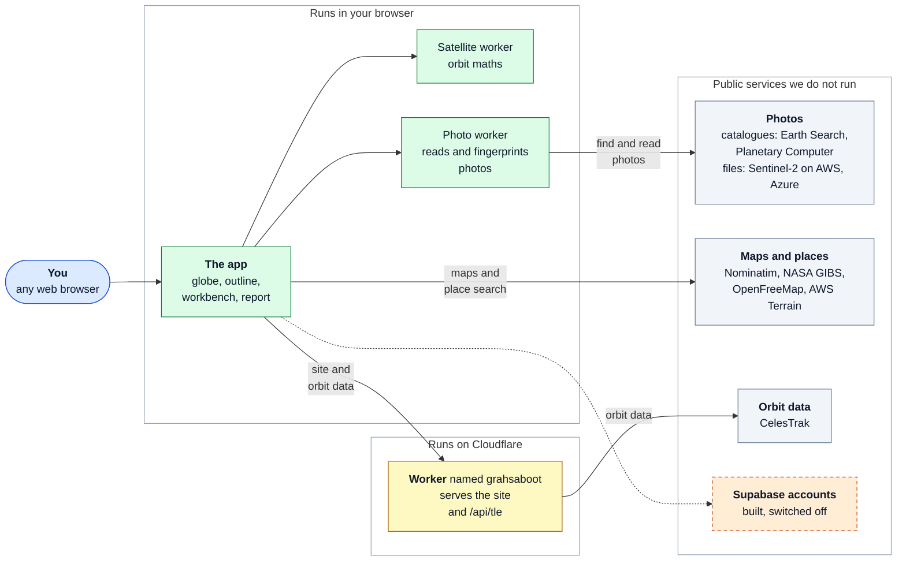
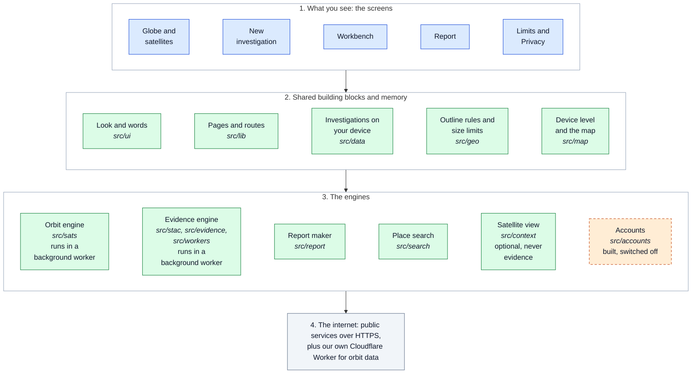
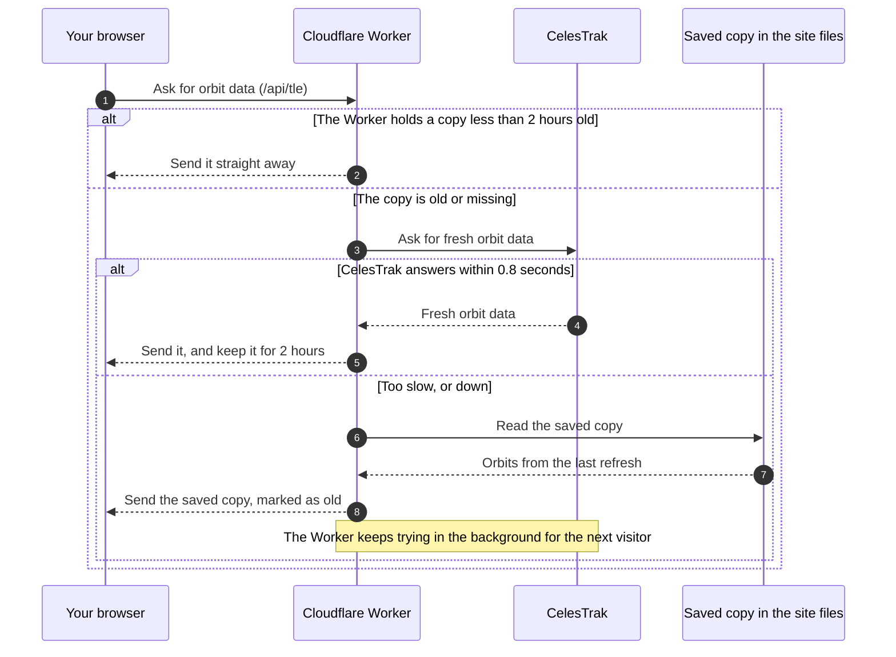
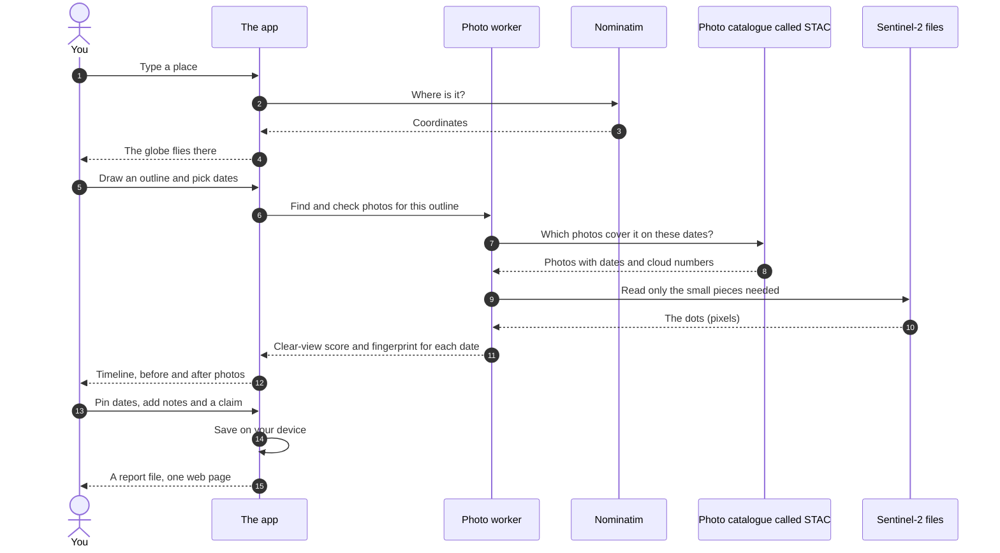
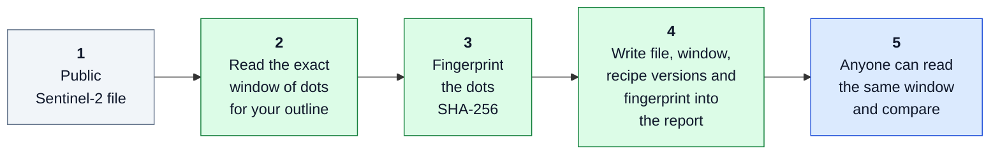
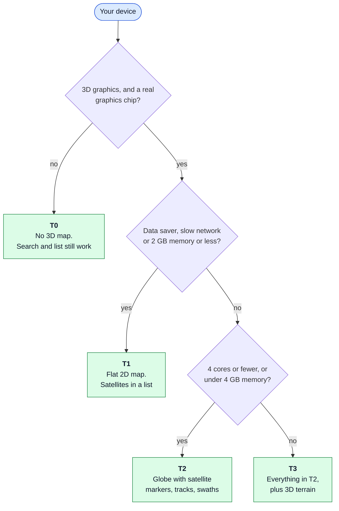

# How GrahSaboot works

The README is the short version; this page holds the detail. It was moved here from the README on 24 October 2026 without changes, except for links and the dated figures noted where they appear.

## How it works

The story in five steps:

1. **You choose a place.** You search by name or type coordinates.
2. **You draw an outline.** It can be a site (an area) or a road (a line with a width).
3. **You choose dates.** The site looks for every satellite photo that covers your outline in that time.
4. **The site checks each photo.** It reads only the small piece of each photo file that covers your outline. It scores how clear the view is, and it makes a fingerprint of those exact dots.
5. **You compare and write the report.** You pin the dates that matter, add notes and a claim, and save the report.

## Architecture

This section shows the same system from five angles. Each diagram answers one question.

| Question                                                  | Diagram                                                                                              |
| --------------------------------------------------------- | ---------------------------------------------------------------------------------------------------- |
| Who talks to whom?                                        | [1. The big picture](#1-the-big-picture)                                                             |
| How is the code organised?                                | [2. Inside the app: the layers](#2-inside-the-app-the-layers)                                        |
| Where do the satellite positions come from?               | [3. Satellite positions and the Cloudflare Worker](#3-satellite-positions-and-the-cloudflare-worker) |
| What happens between typing a place and getting a report? | [4. From a place to a report](#4-from-a-place-to-a-report)                                           |
| Why can someone else trust a report?                      | [5. How a photo becomes evidence](#5-how-a-photo-becomes-evidence)                                   |

Two more diagrams sit next to the text they explain: [which version of the site your device gets](#speed-and-different-devices) and [how a change goes live](development.md#putting-it-online-deploy).

The diagrams are drawn with Mermaid. Each one is shown as a picture, with its Mermaid source folded under it. **Colour key:** blue is you and the screens, green is our code that runs in your browser, yellow is our server on Cloudflare, grey is a public service we do not run, and orange with a dashed edge is built but switched off.

### 1. The big picture


_Who talks to whom: your browser, our one Worker on Cloudflare, and the public services._

<details><summary>Diagram source (Mermaid)</summary>



</details>

Only one thing runs on our side: a small Cloudflare **Worker**. It hands out the website and one route, `/api/tle`, that serves satellite orbit data. Everything else happens in your browser, and your browser talks straight to public services:

| Service                                                    | What we use it for                                                               |
| ---------------------------------------------------------- | -------------------------------------------------------------------------------- |
| Earth Search (Element 84) and Microsoft Planetary Computer | Searching for satellite photos (the catalogue). Planetary Computer is the backup |
| Sentinel-2 files on AWS and Azure                          | The photos themselves, read in small pieces                                      |
| OpenStreetMap Nominatim                                    | Place search                                                                     |
| NASA GIBS                                                  | The picture of the Earth on the globe                                            |
| OpenFreeMap                                                | The flat map: roads, labels, building outlines                                   |
| AWS Terrain Tiles                                          | 3D terrain (top device level only)                                               |
| CelesTrak                                                  | Satellite orbit data, through our Worker                                         |
| Supabase                                                   | Accounts (built, switched off)                                                   |

### 2. Inside the app: the layers


_How the code is organised: four layers, from the screens down to the internet._

<details><summary>Diagram source (Mermaid)</summary>



</details>

Each layer relies on the layer below it. Two walls are checked by automatic tests: the optional satellite view (`src/context`) never feeds a report, and the accounts code (`src/accounts`) can only be reached through one switch.

### 3. Satellite positions and the Cloudflare Worker


_How orbit data reaches your browser, and what happens when CelesTrak is slow._

<details><summary>Diagram source (Mermaid)</summary>



</details>

Your browser works out where each satellite is by itself, using orbit data. The Worker's only job is to fetch that orbit data from CelesTrak, keep it for 2 hours, and never make you wait: if CelesTrak is slow it sends the saved copy at once.

### 4. From a place to a report

![Sequence diagram in 15 steps: you type a place, the app asks Nominatim where it is, and the globe flies there. You draw an outline and pick dates; the photo worker asks the STAC photo catalogue which photos cover it, reads only the small pieces needed from the Sentinel-2 files, and returns a clear-view score and fingerprint for each date. The app shows the timeline and the before and after photos; you pin dates and add notes and a claim; the app saves on your device and gives you a report file, one web page.](diagrams/place-to-report.png)

_Every step between typing a place and getting a report._

<details><summary>Diagram source (Mermaid)</summary>



</details>

### 5. How a photo becomes evidence


_Why someone else can trust a report: they can read the same dots and compare the fingerprint._

<details><summary>Diagram source (Mermaid)</summary>



</details>

A fingerprint (a "hash") is a short code worked out from the dots. If even one dot changed, the code would be completely different. That is how a reader can tell the photos in a report are the real ones.

Every calculation has a version name, for example `scl-v2` for the cloud scoring and `diff-v1` for the brightness difference. The report lists them, so a later reader knows exactly which maths was used. The optional satellite view and the preview pictures are never saved, fingerprinted or put in a report.

## The pages of the website

| Address          | What it is                                                         |
| ---------------- | ------------------------------------------------------------------ |
| `/`              | The globe: live satellites, place search, next pass                |
| `/new`           | Start an investigation: place, outline, dates, review              |
| `/i/<id>`        | The workbench for one investigation                                |
| `/i/<id>/report` | The report for that investigation                                  |
| `/limits`        | What the photos can and cannot show                                |
| `/privacy`       | What the site does with your data                                  |
| `/dev/kit`       | A page for developers that shows the building blocks of the design |
| `/api/tle`       | The only server route: satellite orbit data                        |

## Speed and different devices

The site checks your device and picks one of four levels:

| Level | When                                                             | What you get                                        |
| ----- | ---------------------------------------------------------------- | --------------------------------------------------- |
| T0    | No WebGL2 (3D graphics), or a software graphics chip             | No 3D map. Search and the satellite list still work |
| T1    | Data saver, a slow network (2G or 3G), or 2 GB of memory or less | A flat 2D map. Satellites are listed in the panel   |
| T2    | 4 cores or fewer, or less than 4 GB of memory                    | The globe with satellite markers, tracks and swaths |
| T3    | Everything else                                                  | All of T2, plus 3D terrain                          |

On T1 and T2 you can press "Switch to full". The choice is made in this order:


_Which level your device gets: T0, T1, T2 or T3._

<details><summary>Diagram source (Mermaid)</summary>



</details>

How it stays fast:

- **A small first page.** The JavaScript for the first screen is held to 150 KB compressed. Every other screen is loaded only when you open it (the big map library is its own file, by design).
- **Small reads.** The site reads only the pieces of each photo file that cover your outline, not the whole file.
- **Remembering.** Recently read pieces are kept in your browser so a second look is quick.
- **Background workers.** Orbit maths and photo reading run off the main screen thread, so the page stays smooth.
- **Server cache.** The Worker keeps orbit data for 2 hours. If CelesTrak does not answer within 0.8 seconds, it sends a saved copy right away, and the refresh finishes in the background.

## Built with

| Part          | What we use                                               | What it does for you                                                                |
| ------------- | --------------------------------------------------------- | ----------------------------------------------------------------------------------- |
| The app       | React 19, TypeScript 7, Vite 8                            | Draws the screens, catches mistakes while code is written, builds the website files |
| Looks         | Tailwind CSS 4, Geist fonts, Base UI, Phosphor icons      | Colours, spacing, text, accessible building blocks, icons                           |
| Map and globe | MapLibre GL 6.12, terra-draw 1.36                         | Draws the 3D globe and the flat map, and lets you draw an outline                   |
| Orbits        | satellite.js 7.1                                          | Works out where satellites are from public orbit data                               |
| Photos        | geotiff 3, proj4 2.22                                     | Reads pieces of satellite photo files and converts between map systems              |
| Server        | Cloudflare Workers, Wrangler 4                            | Hands out the site and the `/api/tle` route (free plan)                             |
| Tests         | Vitest 5, Playwright 1.63 with axe-core, Deno 2.9, PGlite | Check the code, real browsers, accessibility, server functions and database rules   |
| Later (off)   | Supabase                                                  | Accounts (see [Accounts](development.md#accounts-built-switched-off))               |

Every package version is pinned exactly in `package.json`, and `package-lock.json` is committed, so a fresh install gives the same result.

## Where things are

```
src/
  app.tsx, main.tsx   routes and the app entry
  config.ts           the web addresses of every service it uses
  styles.css          colours and themes (dark and light)
  screens/            the pages: globe, new investigation, workbench, report, limits and privacy, the design kit, not found
  ui/                 design building blocks, the shell, search box, satellites panel; copy.ts holds the words on screen
  map/                the persistent MapLibre globe, device levels, camera, satellite layers
  sats/               satellite list, orbit maths, next-pass search (in a background worker)
  search/             the Nominatim client (throttled, cached)
  evidence/           the evidence engine: photo pieces, SHA-256, cloud scores, shared grid, difference
  stac/               Sentinel-2 photo search (Earth Search, with Planetary Computer as backup)
  workers/            the photo-reading background worker
  context/            the optional satellite view (an aid for finding a place, never evidence)
  geo/                coordinates and outline limits
  new/                the "new investigation" steps: place, outline, dates, review
  workbench/          the workbench: viewer, timeline, road grid, notes, claim
  report/             the report: HTML, provenance, safe escaping of text
  data/               the investigation model and the on-device store
  lib/                small helpers (router, caching of photo pieces, formatting)
  accounts/           sign-in, save and verify (built, switched off, reached through one flag)
  explore/            the time-lapse (Watch it change): its loader, player and address; the share-link codec is a building block with no screen yet
worker/               the Cloudflare Worker: /api/tle with cache, back-off and saved-copy fallback
supabase/             database migrations and the verify and delete-account functions (not live)
scripts/              the checks run by npm run check, the headers builder, probes, the orbit snapshot tool
dev/                  a page the live checks open to read one photo window in a real browser
public/               icons and tle-snapshot.json
tests/                unit, db (database), e2e (browser), live (real services), fixtures, accounts
docs/                 design mockups, plans, research, probes and operations guides
```
