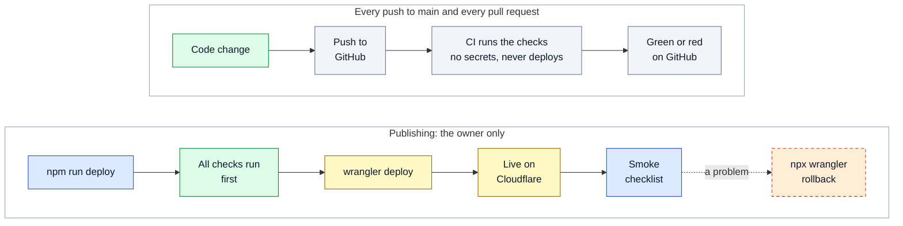

# Running, checking and deploying GrahSaboot

The README is the short version; this page holds the detail. It was moved here from the README on 24 October 2026 without changes, except for links and the dated figures noted where they appear.

## Run it on your computer

**You need:** Node.js 22.12 or newer, and npm (it comes with Node).

```bash
npm ci               # installs the exact packages listed in package-lock.json
npm run dev          # opens the site at http://localhost:5173
```

- `npm run dev` has no Worker. The satellite positions come from the saved copy in `public/tle-snapshot.json`, and nothing calls CelesTrak.
- To try the real `/api/tle` route, run `npm run build && npx wrangler dev`. (`npm run preview` also has no Worker.)

### The commands you will use

| Command                                      | What it does                                                                                                                                         |
| -------------------------------------------- | ---------------------------------------------------------------------------------------------------------------------------------------------------- |
| `npm run dev`                                | Starts the development site                                                                                                                          |
| `npm run build`                              | Builds the website into `dist/` and writes the security headers                                                                                      |
| `npm run preview`                            | Shows the built site locally (no Worker)                                                                                                             |
| `npm run typecheck`                          | Checks the TypeScript code for mistakes                                                                                                              |
| `npm test`                                   | Runs the unit and database tests                                                                                                                     |
| `npm run check`                              | Runs everything above plus the safety guards on three builds (the full gate)                                                                         |
| `npm run e2e`                                | Runs the browser tests with fake data. Pick browsers with `E2E_BROWSERS=chromium,firefox`. First time: `npx playwright install --with-deps chromium` |
| `npm run e2e:live`                           | Runs browser tests against the real services                                                                                                         |
| `npm run check:deno` and `npm run test:deno` | Check and test the server functions (they use Deno)                                                                                                  |
| `npm run bundle` and `npm run csp`           | Run one guard on its own (size budget, security policy)                                                                                              |
| `npm run sync:evidence`                      | Copies the evidence code into the server functions' folder                                                                                           |
| `npm run tle:snapshot`                       | Refreshes the saved orbit copy. At most once every 2 hours                                                                                           |
| `npm run probe`                              | Reads one real photo window and prints its fingerprint (used to compare different runtimes)                                                          |
| `npm run fmt`                                | Tidies the code layout with Prettier                                                                                                                 |
| `npm run deploy`                             | Runs `npm run check`, then publishes (owner only)                                                                                                    |

## Settings

You do **not** need any settings to run the site. Every service address has a public default in `src/config.ts`. You can change any of them with a `VITE_*` variable in your shell or an env file.

| Variable                              | What it changes                                                            | Default                                       |
| ------------------------------------- | -------------------------------------------------------------------------- | --------------------------------------------- |
| `VITE_STAC_URL`                       | The photo catalogue                                                        | Earth Search                                  |
| `VITE_PC_STAC_URL`, `VITE_PC_SAS_URL` | The backup catalogue (Planetary Computer) and its access-token address     | Planetary Computer                            |
| `VITE_NOMINATIM_URL`                  | Place search                                                               | OpenStreetMap Nominatim                       |
| `VITE_TLE_URL`                        | Where orbit data comes from                                                | `/api/tle` (in `npm run dev`: the saved copy) |
| `VITE_STYLE_DARK`, `VITE_STYLE_LIGHT` | The map drawing styles                                                     | OpenFreeMap dark and positron                 |
| `VITE_GIBS_TILES`                     | The globe pictures                                                         | NASA GIBS Blue Marble                         |
| `VITE_TERRAIN_TILES`                  | 3D terrain                                                                 | AWS Terrain Tiles                             |
| `VITE_CONTEXT_IMAGERY=0`              | Builds the site **without** the satellite view (`npm run build:nocontext`) | on                                            |

Accounts have their own settings (`VITE_ACCOUNTS`, `VITE_SUPABASE_URL`, `VITE_SUPABASE_PUBLISHABLE_KEY`, and tooling secrets). They are explained in `.env.example` and are only for developers testing accounts. Real secrets must never be committed (the real `.env*` files are git-ignored). `npm run env:check` checks the pair of files.

## Checks that keep it safe

`npm run check` is the full gate. GitHub runs it for every push to `main` and every pull request, with the extra steps described under the table.

| Check                 | What it protects                                                                                  | How to run it                             |
| --------------------- | ------------------------------------------------------------------------------------------------- | ----------------------------------------- |
| Type check            | Catches mistakes before the code runs                                                             | `npm run typecheck`                       |
| Unit tests            | Small pieces of logic behave as intended                                                          | `npm test`                                |
| Database tests        | The rules of the accounts database (run in memory, nothing real is touched)                       | part of `npm test`                        |
| Three builds          | The normal build, a build with accounts (for testing only) and a build without the satellite view | part of `npm run check`                   |
| Size budget           | The first page loads at most 150 KB of JavaScript (compressed)                                    | `npm run bundle`                          |
| Accounts guard        | The normal build holds no accounts code, words or storage keys                                    | `npm run bundle`                          |
| Security policy check | Every web address the code uses is listed, with no wildcards and no `unsafe-eval`                 | `npm run csp`                             |
| Evidence copy check   | The server's copy of the evidence code matches the browser's                                      | `npm run sync:evidence`                   |
| Server function tests | The (switched-off) server functions type-check and pass tests in Deno                             | `npm run check:deno`, `npm run test:deno` |
| Browser tests         | Real browsers walk through the main flows with fake data                                          | `npm run e2e`                             |
| Accessibility tests   | Every screen passes axe (WCAG 2.2 AA) in both themes                                              | part of `npm run e2e`                     |
| Live checks           | The same flows against the real services, including photo fingerprints                            | `npm run e2e:live`                        |

CI (`.github/workflows/ci.yml`) uses Node 22. It holds **no secrets** and **never deploys**. It runs `npm run check`, a check that the server's evidence copy is committed, the Deno checks and tests, and the browser tests in Chromium (the desktop, phone-sized and accounts projects). It does not run the live checks, Firefox or WebKit: those are run by hand.

**What the checks held on 24 October 2026**, in the full run on the code that is live (the time-lapse's line drawing included). All 1,710 unit tests (105 files, the database tests among them) and all 62 server-function tests in Deno pass. In the browser tests, run by hand on a laptop, 735 pass in Chromium, a phone-sized Chromium and the accounts build, 340 in WebKit and 340 in Firefox, and none fail; 24 more skip themselves by design (a touch test on a desktop browser, for example). The live checks pass in all three browsers, 3 of 3 in each. The first page's JavaScript is 100.0 KB compressed, inside the 150 KB limit. GitHub's CI on the same code failed twice. Both times, two phone-sized tests of the satellites switch timed out while the hosted runner drew the 3D map in software; the second time, a layout timing test of the workbench failed too. All of them passed on the laptop in every engine. Since 24 October 2026 those two phone-sized tests skip on the hosted runner only. (The README before this rewrite gave an earlier run: 1,697 unit tests, 715, 330 and 330 browser tests, 100.2 KB.)

## Putting it online (deploy)

The site runs on **Cloudflare Workers** (free plan) as a Worker named `grahsaboot`. It is not on Vercel.

```bash
npm run tle:snapshot   # optional: refresh the saved orbits, at most once every 2 hours
npm run deploy         # runs npm run check, then wrangler deploy
```


_How a change goes live: CI only checks, and only the owner publishes._

<details><summary>Diagram source (Mermaid)</summary>



</details>

- Only the owner deploys. Pushing to GitHub deploys nothing.
- `npm run deploy` always publishes the build **without** accounts.
- After a deploy, run the smoke checklist in [`docs/ops/deploy.md`](ops/deploy.md). If something is wrong: `npx wrangler rollback`.
- Logs: `npx wrangler tail grahsaboot`. Observability is switched on.
- The build writes `dist/_headers` (the security policy and headers) from the list of web addresses the code really uses (`scripts/csp.ts`). `npm run check` holds that file to the rules.

## Accounts (built, switched off)

Sign-in with Google, saving, and a server re-check of every photo are written and tested. They sit behind a build flag. A normal build holds **no** accounts code, words, requests or storage keys, and a guard in `npm run check` proves that every time. The owner switches accounts on only after a tester has tried them on a development project ([`docs/ops/accounts-test.md`](ops/accounts-test.md)). `npm run deploy` never ships them. The live site has no accounts.
